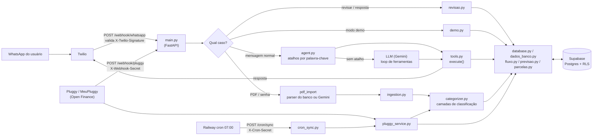
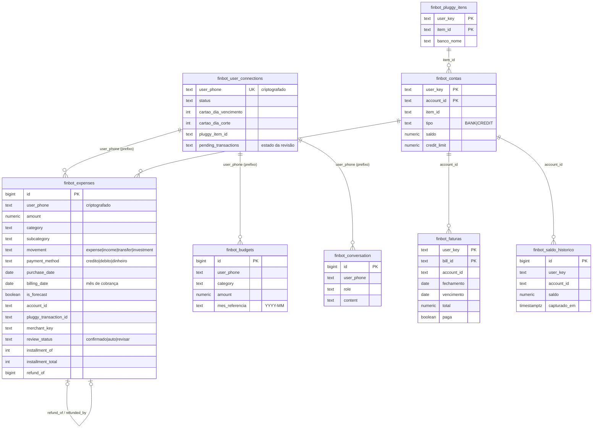

# DER do FinBot

Mapa do banco de dados (Supabase / Postgres). Gerado junto com a página DER; mantenha os dois em sincronia.

Colunas marcadas com † não vêm de migração: foram inferidas do código. Para conferir o esquema real:

```sql
select table_name, column_name, data_type, is_nullable
from information_schema.columns
where table_schema = 'public' and table_name like 'finbot\_%' and table_name not like '%bkp%'
order by table_name, ordinal_position;
```

## Convenções

- **user_key**: Os primeiros 16 caracteres de user_phone (prefixo HMAC do telefone). Identifica o usuário nas tabelas sem criptografia (contas, faturas, histórico, aliases). Cada pessoa da família que usa o FinBot tem o seu.
- **user_phone criptografado**: Nas tabelas finbot_expenses, user_connections, conversation e budgets o telefone é guardado como «prefixo:cifra». O prefixo é determinístico (permite buscar); a cifra não é.
- **billing_date**: Mês de cobrança, usado em todos os relatórios. Cartão: dia 1 do mês de vencimento da fatura. Débito e Pix: a data do lançamento.
- **is_forecast**: true enquanto a fatura do lançamento não fechou. O sync corrige para false depois do fechamento.
- **Ciclo da transação**: billId da Pluggy primeiro; transação PENDING sem billId em ciclo já fechado vai para o próximo; senão vale o ciclo da data da compra (inclusive o dia do fechamento).
- **Parcelas previstas**: Não ficam no banco: app/parcelas.py projeta, em tempo de leitura, as parcelas futuras a partir da última parcela conhecida de cada compra.
- **RLS e chaves**: Todas as tabelas têm Row Level Security ligado, sem políticas: só a chave de serviço (sb_secret_...) acessa. A chave anon não lê nada.
- **Modo demonstração**: Usuário sintético com telefone whatsapp:+0<número>, contas/faturas/lançamentos com ids «demo-...». Nunca fala com a Pluggy e é apagado ao sair do modo.

## Fluxo do dado



## DER 1 · Lançamentos, usuário e bancos

Quase nenhuma ligação é FOREIGN KEY: o vínculo é por valor (user_phone por prefixo, user_key, account_id, item_id).



## DER 2 · Classificação e taxonomia

```mermaid
erDiagram
  finbot_categories ||--o{ finbot_subcategories : "category_id"
  finbot_categories ||--o{ finbot_merchant_mappings : "category_id"
  finbot_subcategories ||--o{ finbot_merchant_mappings : "subcategory_id"
  finbot_subcategories ||--o{ finbot_expenses : "subcategory_id"
  finbot_expenses }o--o{ finbot_user_merchant_stats : "user_key + merchant_key"
  finbot_tax_categories ||--o{ finbot_tax_subcategories : "category_code"
  finbot_tax_subcategories ||--o{ finbot_tax_map : "subcategory_code"
  finbot_tax_beneficiaries |o--o{ finbot_tax_map : "beneficiary_code"
  finbot_categories {
    int id PK
    text name
    text emoji
  }
  finbot_subcategories {
    int id PK
    text name
    int category_id FK
  }
  finbot_merchant_mappings {
    text merchant_name UK
    int category_id FK
    int subcategory_id FK
  }
  finbot_user_merchant_stats {
    text user_key PK
    text merchant_key PK
    text category PK
    text subcategory PK
    int n
  }
  finbot_expenses {
    bigint id PK
    text merchant_key
    int subcategory_id FK
  }
  finbot_tax_categories {
    text code PK
    text name UK
    text movement
  }
  finbot_tax_subcategories {
    text code PK
    text category_code FK
    text name
  }
  finbot_tax_beneficiaries {
    text code PK
    text name
  }
  finbot_tax_map {
    text old_category PK
    text old_subcategory PK
    text subcategory_code FK
    text beneficiary_code FK
  }
```



## Como um lançamento é classificado

1. **Histórico do usuário**: finbot_user_merchant_stats: o que ele já confirmou para este estabelecimento (confiança 0,95).
2. **Regras fixas**: Família, saúde, auto, vestuário (ex.: «zerezes»): termos que sempre valem.
3. **Aprendizado global**: finbot_merchant_mappings: mapeamento aprendido de estabelecimento para categoria.
4. **Palavras-chave**: Dicionário de termos por categoria.
5. **MCC e categoria da Pluggy**: Código do tipo de estabelecimento (payeeMCC), depois a categoria genérica da Pluggy.
6. **LLM (Gemini)**: Com dica da pesquisa na web (Google Search) quando o lugar é desconhecido.
7. **Revisão**: Dúvida restante vira pergunta ao usuário (review_status = revisar).

## Dicionário de dados

### Núcleo

#### `finbot_expenses`

Lançamentos. Uma linha por transação (despesa, receita, transferência, investimento), vinda da Pluggy, de PDF ou digitada no WhatsApp. É a tabela central: quase tudo no FinBot lê daqui.

_Origem: Criada fora das migrações; colunas de 001, 005, 007, 008, 010 e 012 mais o que o código usa (colunas marcadas † foram inferidas do código)._

| Coluna | Tipo | Chave | Descrição |
|---|---|---|---|
| `id` | `bigint` | PK | Identificador. |
| `user_phone` | `text` | cript | Telefone criptografado no formato «prefixo HMAC de 16 caracteres : cifra». Como a cifra muda a cada gravação, filtra-se pelo prefixo (ilike 'prefixo:%'). user_key = split_part(user_phone, ':', 1). |
| `amount` | `numeric` |  | Valor sempre positivo. Quem diz se entra ou sai é transaction_type / movement. |
| `category` | `text` |  | Categoria (nome da taxonomia v2: Moradia, Alimentação...). |
| `subcategory` | `text` |  | Subcategoria (nome da taxonomia v2). |
| `subcategory_id †` | `int` | FK | Referência a finbot_subcategories.id, preenchida na gravação quando o nome é válido. |
| `description` | `text` |  | Descrição como veio do banco (ou digitada). |
| `beneficiary †` | `text` |  | Para quem foi o gasto: self, family, children, pet ou home. |
| `transaction_type` | `text` |  | expense ou income, como veio da origem. |
| `movement` | `text NOT NULL` |  | Movimento definitivo: expense, income, transfer ou investment. Decidido pela função finbot_movement() via trigger. Todos os relatórios filtram por esta coluna, e não por transaction_type. |
| `contexto` | `text NOT NULL` |  | pessoal (padrão) ou negocio. |
| `payment_method` | `text` |  | credito, debito ou dinheiro. 'credito' é o que liga a linha a uma fatura de cartão. |
| `payment_channel` | `text NOT NULL` |  | Canal inferido por trigger: credit_card, debit_card, pix, boleto, bank_transfer, direct_debit, cash, unknown. |
| `purchase_date` | `date` |  | Data da compra / do lançamento. |
| `billing_date` | `date` |  | Mês de cobrança. Cartão: dia 1 do mês de vencimento da fatura. Débito/Pix: a própria data. Todo relatório mensal usa esta coluna. |
| `is_forecast` | `boolean` |  | true = a fatura ainda não fechou (o valor pode mudar). Vira false no sync depois do fechamento. |
| `account_id` | `text` | ref | Conta/cartão na Pluggy (finbot_contas.account_id). Ligação lógica: não há FOREIGN KEY. |
| `pluggy_transaction_id` | `text` |  | Id da transação na Pluggy; PDF usa um hash. Base da deduplicação. |
| `merchant_key` | `text` |  | Nome normalizado do estabelecimento; chave do aprendizado e do histórico do usuário. |
| `review_status` | `text NOT NULL` |  | confirmado (padrão), auto ou revisar. Só despesa pode ficar 'revisar'. |
| `confidence` | `numeric` |  | Confiança da classificação: 1,0 confirmado; 0,95 histórico; 0,75 primeiro palpite; 0,5 dúvida; 0 sem ideia. |
| `installment_of` | `int` |  | Número da parcela (n). |
| `installment_total` | `int` |  | Total de parcelas (N). Índice único uq_finbot_expenses_parcela evita parcela duplicada. |
| `refund_of` | `bigint` | ref | No estorno: id da cobrança estornada (finbot_expenses.id). |
| `refunded_by` | `bigint` | ref | Na cobrança: id do estorno que a anulou. |
| `pre_refund_movement / _category / _subcategory` | `text` |  | Como a linha era antes de formar o par cobrança/estorno (permite desfazer). |
| `created_at †` | `timestamptz` |  | Quando o FinBot gravou a linha. |

- Triggers: trg_finbot_expenses_movement (antes de gravar: define movement), trg_finbot_expenses_channel (define payment_channel), finbot_expenses_zz_pair_refund (depois de inserir: pareia estornos).
- Índices: movement; review_status='revisar' (parcial); account_id (parcial); refund_of (parcial); parcela única.

#### `finbot_user_connections`

Uma linha por usuário: configuração do cartão, vínculo padrão com a Pluggy e o estado da conversa (pergunta de revisão ou PDF pendente).

_Origem: Criada fora das migrações; colunas inferidas do código (†)._

| Coluna | Tipo | Chave | Descrição |
|---|---|---|---|
| `user_phone †` | `text UNIQUE` | cript | Telefone criptografado (chave de upsert). |
| `status †` | `text` |  | ativo, aguardando_categorizacao, aguardando_senha ou processando. |
| `cartao_dia_vencimento †` | `int` |  | Dia de vencimento informado no onboarding. |
| `cartao_dia_corte †` | `int` |  | Dia de fechamento do cartão. |
| `pluggy_item_id †` | `text` |  | Item padrão na Pluggy, em texto puro (usado pelo webhook para achar o usuário). |
| `pluggy_account_id †` | `text` | ref | Conta padrão (finbot_contas.account_id). |
| `pending_transactions †` | `text (JSON)` |  | Estado da fila de revisão ou das transações aguardando categoria. |
| `pending_transactions_at †` | `timestamptz` |  | Quando o estado pendente foi gravado (expira). |
| `pending_pdf_url †` | `text` |  | URL do PDF aguardando senha/processamento. |


#### `finbot_conversation`

Histórico da conversa com o agente (últimas mensagens alimentam o contexto do LLM).

_Origem: Criada fora das migrações; colunas inferidas do código (†)._

| Coluna | Tipo | Chave | Descrição |
|---|---|---|---|
| `id †` | `bigint` | PK | Identificador. |
| `user_phone` | `text` | cript | Telefone criptografado. |
| `role` | `text` |  | user ou assistant. |
| `content` | `text` |  | Texto da mensagem. |
| `created_at †` | `timestamptz` |  | Ordem cronológica. |


#### `finbot_budgets`

Limite mensal por categoria. Vale o limite mais recente com mes_referencia menor ou igual ao mês consultado.

_Origem: Criada fora das migrações; colunas conforme o código._

| Coluna | Tipo | Chave | Descrição |
|---|---|---|---|
| `id` | `bigint` | PK | Identificador. |
| `user_phone` | `text` | cript | Telefone criptografado. |
| `category` | `text` |  | Nome da categoria (comparado sem acento/caixa). |
| `amount` | `numeric` |  | Limite em reais. |
| `mes_referencia` | `text` |  | Mês no formato YYYY-MM em que o limite passa a valer. |


### Banco (Pluggy)

#### `finbot_pluggy_itens`

Bancos conectados por usuário (um item da Pluggy = uma instituição).

_Origem: Migração 005._

| Coluna | Tipo | Chave | Descrição |
|---|---|---|---|
| `user_key` | `text` | PK | Prefixo de 16 caracteres do telefone (o mesmo de user_phone). |
| `item_id` | `text` | PK | Id do item na Pluggy. |
| `banco_codigo` | `text` |  | Código do banco, ex.: 341. |
| `banco_nome` | `text` |  | Ex.: Itaú. |
| `criado_em` | `timestamptz` |  | Quando foi vinculado. |


#### `finbot_contas`

Contas correntes e cartões, com o último saldo informado pelo banco.

_Origem: Migrações 004 e 005._

| Coluna | Tipo | Chave | Descrição |
|---|---|---|---|
| `user_key` | `text` | PK | Prefixo de 16 caracteres do telefone. |
| `account_id` | `text` | PK | Id da conta na Pluggy. |
| `item_id` | `text` | ref | Banco (finbot_pluggy_itens.item_id). |
| `tipo` | `text` |  | BANK ou CREDIT. |
| `nome` | `text` |  | Nome automático (vindo da Pluggy). |
| `apelido` | `text` |  | Nome dado pelo usuário; o sync nunca sobrescreve. |
| `banco_nome` | `text` |  | Nome da instituição. |
| `saldo` | `numeric` |  | BANK: saldo disponível. CREDIT: saldo devedor (fatura aberta). |
| `credit_limit` | `numeric` |  | Limite do cartão. |
| `available_limit` | `numeric` |  | Limite disponível. |
| `atualizado_banco` | `timestamptz` |  | Última atualização do item no banco/Pluggy. |
| `sincronizado_em` | `timestamptz` |  | Quando o FinBot buscou o dado. |


#### `finbot_faturas`

Ciclos de fatura de cada cartão: fechamento, vencimento, total do banco e se foi paga.

_Origem: Migração 004._

| Coluna | Tipo | Chave | Descrição |
|---|---|---|---|
| `user_key` | `text` | PK | Prefixo de 16 caracteres do telefone. |
| `bill_id` | `text` | PK | Id da fatura na Pluggy. |
| `account_id` | `text` | ref | Cartão (finbot_contas.account_id). |
| `vencimento` | `date` |  | Data de vencimento. |
| `fechamento` | `date` |  | Data de fechamento. |
| `fechamento_estimado` | `boolean` |  | true = o banco não informou o fechamento; foi estimado. |
| `total` | `numeric` |  | Total do banco. Nulo enquanto a fatura não fechou. |
| `paga` | `boolean` |  | Fatura paga. |
| `sincronizado_em` | `timestamptz` |  | Quando foi buscada. |

- Índice: (user_key, account_id, vencimento desc).

#### `finbot_saldo_historico`

Série histórica dos saldos (uma linha cada vez que o saldo muda).

_Origem: Migração 004._

| Coluna | Tipo | Chave | Descrição |
|---|---|---|---|
| `id` | `bigserial` | PK | Identificador. |
| `user_key` | `text` |  | Prefixo do telefone. |
| `account_id` | `text` | ref | Conta (finbot_contas.account_id). |
| `saldo` | `numeric NOT NULL` |  | Saldo capturado. |
| `capturado_em` | `timestamptz` |  | Momento da captura. |

- Índice: (user_key, account_id, capturado_em desc).

### Classificação

#### `finbot_categories`

Categorias oficiais (nome + emoji) usadas na gravação e nas mensagens.

_Origem: Criada fora das migrações; colunas inferidas (†)._

| Coluna | Tipo | Chave | Descrição |
|---|---|---|---|
| `id †` | `int` | PK | Identificador. |
| `name` | `text` |  | Nome (taxonomia v2). |
| `emoji` | `text` |  | Emoji da categoria. |


#### `finbot_subcategories`

Subcategorias oficiais, ligadas à categoria.

_Origem: Criada fora das migrações; colunas inferidas (†)._

| Coluna | Tipo | Chave | Descrição |
|---|---|---|---|
| `id` | `int` | PK | Identificador. |
| `name` | `text` |  | Nome exato (ex.: Padaria e Café). |
| `category_id †` | `int` | FK | finbot_categories.id. |


#### `finbot_merchant_mappings`

Aprendizado global: estabelecimento → categoria/subcategoria (vale para todos os usuários).

_Origem: Criada fora das migrações; colunas inferidas (†)._

| Coluna | Tipo | Chave | Descrição |
|---|---|---|---|
| `merchant_name` | `text UNIQUE` |  | Nome do estabelecimento (chave de upsert). |
| `category_id` | `int` | FK | finbot_categories.id. |
| `subcategory_id` | `int` | FK | finbot_subcategories.id. |


#### `finbot_user_merchant_stats`

Histórico por usuário: quantas vezes cada estabelecimento foi classificado em cada categoria (base do palpite «história do usuário»).

_Origem: Migração 001._

| Coluna | Tipo | Chave | Descrição |
|---|---|---|---|
| `user_key` | `text` | PK | Prefixo do telefone. |
| `merchant_key` | `text` | PK | Nome normalizado, ex.: padaria sao joao ou familia:mercadolivre. |
| `category` | `text` | PK | Categoria. |
| `subcategory` | `text` | PK | Subcategoria. |
| `n` | `integer` |  | Contagem de usos. |
| `last_at` | `timestamptz` |  | Último uso. |

- Escrita pela função finbot_incr_merchant_stat(user_key, merchant_key, category, subcategory, n).

#### `finbot_user_aliases`

Nomes do próprio titular, para reconhecer Pix/TED entre contas próprias como transferência.

_Origem: Migração 007._

| Coluna | Tipo | Chave | Descrição |
|---|---|---|---|
| `id` | `bigint identity` | PK | Identificador. |
| `user_key` | `text` |  | Prefixo do telefone. |
| `nome` | `text` |  | Nome como aparece na descrição. |

- UNIQUE (user_key, nome).

### Taxonomia v2

#### `finbot_tax_categories`

Tabela de referência da taxonomia v2 (19 categorias com tipo de movimento).

_Origem: Migração 009._

| Coluna | Tipo | Chave | Descrição |
|---|---|---|---|
| `code` | `text` | PK | Código estável (moradia, alimentacao...). |
| `name` | `text UNIQUE` |  | Nome exibido. |
| `emoji` | `text` |  | Emoji. |
| `movement` | `text` |  | expense, income, transfer ou investment. |
| `sort_order` | `int` |  | Ordem. |
| `active` | `boolean` |  | Ativa. |


#### `finbot_tax_subcategories`

Subcategorias da taxonomia v2.

_Origem: Migração 009._

| Coluna | Tipo | Chave | Descrição |
|---|---|---|---|
| `code` | `text` | PK | Código. |
| `category_code` | `text` | FK | finbot_tax_categories.code. |
| `name` | `text` |  | Nome (único dentro da categoria). |
| `definition` | `text` |  | Definição de uso. |
| `sort_order` | `int` |  | Ordem. |
| `active` | `boolean` |  | Ativa. |


#### `finbot_tax_beneficiaries`

Beneficiários possíveis do gasto: Eu, Família, Filhos, Pet, Casa.

_Origem: Migração 009._

| Coluna | Tipo | Chave | Descrição |
|---|---|---|---|
| `code` | `text` | PK | self, family, children, pet ou home. |
| `name` | `text` |  | Nome. |
| `sort_order` | `int` |  | Ordem. |


#### `finbot_tax_map`

De-para da taxonomia antiga para a nova (usado na migração 011).

_Origem: Migração 009._

| Coluna | Tipo | Chave | Descrição |
|---|---|---|---|
| `old_category` | `text` | PK | Categoria antiga. |
| `old_subcategory` | `text` | PK | Subcategoria antiga. |
| `subcategory_code` | `text` | FK | finbot_tax_subcategories.code. |
| `beneficiary_code` | `text` | FK | finbot_tax_beneficiaries.code (opcional). |
| `rows_count` | `int` |  | Linhas afetadas. |
| `possible_targets` | `int` |  | Quantos destinos eram possíveis. |


## Funções do banco

- `finbot_movement(desc, amount, ttype, user_phone)`: Decide o movimento (expense / income / transfer / investment): pagamento de fatura, nome do próprio titular, valor ≤ R$ 1 e investimentos viram transferência/investimento.
- `finbot_reclassify_movement(user_key)`: Reaplica a regra ao histórico do usuário (chamada ao cadastrar o nome do titular).
- `finbot_payment_channel(desc, método)`: Infere o canal de pagamento (pix, boleto, direct_debit, credit_card...).
- `finbot_pair_refunds(user_key)`: Pareia cobrança e estorno (refund_of / refunded_by) e neutraliza o par.
- `finbot_incr_merchant_stat(...)`: Soma 1 (ou n) ao histórico do usuário para um estabelecimento.
- `finbot_unaccent / finbot_sem_acento`: Normalização de texto sem acento para as regras acima.

## Tabelas de backup

- `finbot_categories_bkp_tax`
- `finbot_contas_bkp_20261024`
- `finbot_expenses_bkp_20261016`
- `finbot_expenses_bkp_20261024`
- `finbot_expenses_bkp_cartao`
- `finbot_expenses_bkp_channel`
- `finbot_expenses_bkp_fatura / fatura2 / fatura3`
- `finbot_expenses_bkp_forma`
- `finbot_expenses_bkp_mov`
- `finbot_expenses_bkp_tax`
- `finbot_expenses_debito_bkp`
- `finbot_merchant_mappings_bkp / _bkp_20261018 / _bkp_tax`
- `finbot_pluggy_itens_bkp_20261024`
- `finbot_subcategories_bkp_tax`
- `finbot_user_merchant_stats_bkp_tax`
- `finbot_tax_categorias / finbot_tax_subcategorias (versões antigas da taxonomia)`
